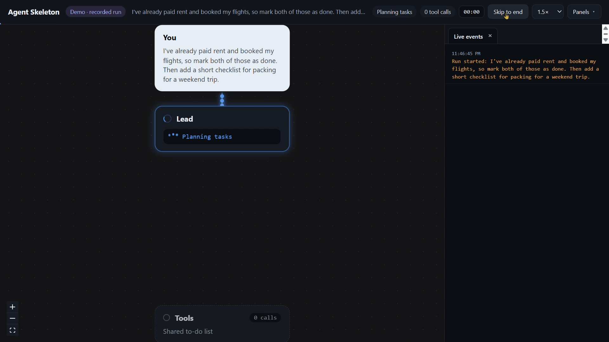

# Agent Skeleton

A barebones, copy-paste skeleton for building AI agents and workflows from scratch, with a live dashboard to watch them work. Plug in your own tools and any AI provider, and go.



**[▶ Live demo](https://carterlafosse.github.io/agent-skeleton/)**: watch a team of AI agents plan, call tools, and pause for human approval. No setup needed.

## Highlights

- **Built from scratch.** No agent framework: every loop, workflow and hand-off is plain Python you can read and copy.
- **Five step-by-step chapters**, from a single tool call to a team of agents.
- **Live visualizer.** Watch agents work in parallel as a graph, replay runs at any speed, and start or stop runs from the dashboard.
- **Human approval.** Risky actions pause until you click Approve or Deny.
- **Any AI provider.** Claude, OpenAI, Gemini, DeepSeek, Grok, GitHub Models, OpenRouter, or local models with Ollama.

## Chapters

| Chapter | Topic | What you learn |
|---|---|---|
| [01](01-single-call/) | Single tool call | How a model asks your code to run a tool |
| [02](02-agent-loop/) | Agent loop | The loop that turns a model into an agent |
| [03](03-workflows/) | Workflows | Chaining, routing, parallel calls, and self-checking |
| [04](04-multi-agent/) | Multi-agent | A lead that splits work between worker agents |
| [05](05-visualizer/) | Visualizer | A live dashboard with replays and human approval |

Each chapter builds on the last. Start at 01 and work through in order.

## Quickstart

1. Create and activate a virtual environment:
   ```bash
   python -m venv .venv
   .venv\Scripts\Activate.ps1      # Windows
   source .venv/bin/activate       # Mac/Linux
   ```
2. Install dependencies:
   ```bash
   pip install -r requirements.txt
   ```
3. Copy `.env.example` to `.env`, choose your AI provider, and add its API key (see below).
4. Run the first chapter:
   ```bash
   python 01-single-call/single_call.py
   ```

## Run the visualizer

You need [Node.js](https://nodejs.org) installed. Use two terminals:

```bash
# Terminal 1: the server
cd 05-visualizer/server
npm install      # first time only
npm start
```

```bash
# Terminal 2: the dashboard
cd 05-visualizer/dashboard
npm install      # first time only
npm run dev
```

Open http://localhost:5173 and click **▶ New run**. Full details are in the [Chapter 05 README](05-visualizer/).

## Use any AI provider

Set `PROVIDER=` in `.env` and add that provider's key. Every chapter works with all of them.

| `PROVIDER=` | Service | Key in `.env` |
|---|---|---|
| `anthropic` | Claude (default) | `ANTHROPIC_API_KEY` |
| `openai` | ChatGPT models | `OPENAI_API_KEY` |
| `gemini` | Google Gemini | `GEMINI_API_KEY` |
| `deepseek` | DeepSeek | `DEEPSEEK_API_KEY` |
| `grok` | xAI Grok | `XAI_API_KEY` |
| `github` | GitHub Models (free tier with a GitHub token) | `GITHUB_TOKEN` |
| `openrouter` | Hundreds of models with one key | `OPENROUTER_API_KEY` |
| `ollama` | Models running on your own computer | none |

Add `MODEL=` to pick a specific model, or `BASE_URL=` for any other OpenAI-compatible service. It all lives in `shared/llm.py`: Claude is called directly, and every other provider goes through OpenAI's API format, with replies converted so the chapters never need to know which one is in use.

## Make it yours

All tools live in `shared/tools.py`. Write a function, put `@tool(...)` above it, and every chapter can use it:

```python
@tool("get_time", "Get the current time.", {})
def get_time():
    from datetime import datetime
    return datetime.now().strftime("%H:%M")
```

Add `risky=True` to a tool that changes or deletes things, and the visualizer will ask for your approval before it runs.

## Project layout

```
shared/           llm.py (any provider), tools.py (tool registry),
                  emit.py + approval.py (talk to the visualizer)
01-single-call/   one tool call
02-agent-loop/    the agent loop
03-workflows/     four workflow patterns
04-multi-agent/   lead + workers
05-visualizer/    Node server + React dashboard
main.py           runs the Chapter 04 team (used by the dashboard)
```
